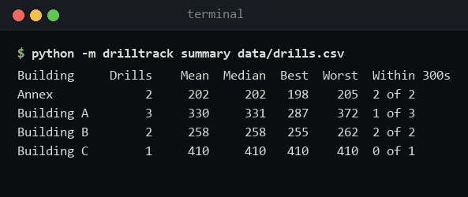

# evacuation-drill-tracker

A drill log with timing statistics per building and an alert for buildings that are overdue for a drill.



## What it is for

Fire codes and insurance rules expect regular evacuation drills, and a safety officer has to show that each building did one, how long it took, and what went wrong. Most sites keep this in scattered emails and paper sheets. A facility coordinator or building manager records each drill as one line in a CSV file. The tool then shows the average, best and worst evacuation time for each building, whether times are getting better, and which buildings have gone too long without a drill.

## Install

```
git clone https://github.com/yassine2med/evacuation-drill-tracker
cd evacuation-drill-tracker
python -m pip install -r requirements.txt pytest
```

## How to use

The log is a CSV with the columns `date, building, drill_type, evac_seconds, headcount, issues`.

| I want to | Command |
|---|---|
| See mean, median, best, worst time and how many drills met the target, per building | `python -m drilltrack summary FILE [--target SECONDS]` (default target 300) |
| See every drill of one building with the change since the previous one | `python -m drilltrack trend FILE --building NAME` |
| List buildings with no drill within the interval | `python -m drilltrack overdue FILE --today YYYY-MM-DD [--interval-days N]` (default 180) |

Exit code is 0 for a clean run, 1 when `overdue` finds buildings, 2 for bad input.

Examples with the sample data:

```
$ python -m drilltrack summary data/drills.csv
Building     Drills    Mean  Median  Best  Worst  Within 300s
Annex             2     202     202   198    205  2 of 2
Building A        3     330     331   287    372  1 of 3
Building B        2     258     258   255    262  2 of 2
Building C        1     410     410   410    410  0 of 1

$ python -m drilltrack trend data/drills.csv --building "Building A"
2025-09-10  fire        372s   first  Stairwell B door stuck
2026-03-12  fire        331s    -41s
2026-09-15  fire        287s    -44s

$ python -m drilltrack overdue data/drills.csv --today 2026-11-19
Building C   last drill 2025-06-20  (517 days ago)
Building B   last drill 2026-04-08  (225 days ago)
2 building(s) overdue
```

## How it works

- The CSV is read with the standard `csv` module. Missing columns, bad dates, non-numeric or non-positive times and empty building names stop the run with a line number.
- `summary` groups drills by building and uses the `statistics` module for mean and median.
- `trend` lists the drills of one building by date and subtracts the previous time.
- `overdue` compares today with each building's most recent drill. A building is overdue only when the gap is more than the interval.

## Limits

- Times are whole seconds that someone measured by hand; the tool does not check them.
- One target time for all buildings and drill types in a single run.
- It does not send reminders or draw charts.

MIT license. Copyright 2026 Yassine Emhamed.
